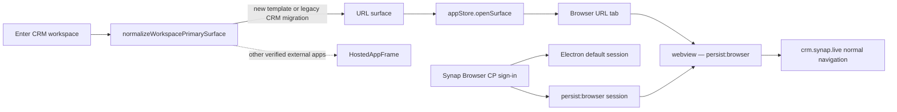

# CRM Workspace Browser Experience — Engineering Handoff

This document records the July 2026 work that made workspace entry configurable, introduced lens-aware empty-state onboarding, and ultimately changed the CRM workspace from a special iframe-hosted application into an ordinary website running in Synap Browser's normal web session.

It is written for an AI or engineer continuing the work without access to the original debugging conversation.

## Executive state

The intended final behavior is:

- Opening the CRM workspace opens `https://crm.synap.live` as a normal Browser URL surface.
- The Browser keeps its immersive workspace presentation and top islands while the website uses ordinary navigation, redirects, cookies, and login behavior.
- CRM must not enter `HostedAppFrame`, call the Control Plane `/pods/handshake` endpoint, or call a Pod `/api/federation/exchange` endpoint merely to display the website.
- A Control Plane account session established through Synap Browser is mirrored into the `persist:browser` Electron partition, so normal first-party websites can reuse it.
- Old workspaces that persisted CRM as an `external-app` are converted at the Browser boundary; updating every Pod is not required for this compatibility transition.
- True SDK-integrated hosted applications still use the external-app infrastructure. That infrastructure was not globally deleted.

The final CRM routing and session-sharing changes are present in:

- `browser` commit `ca09622b`
- `synap-app` commit `561435563`
- The logged-out OAuth return bridge is in `synap-landing` commit `5d0e47d`

These are broad consolidation commits. Do not blindly cherry-pick them into another branch; inspect the specific files listed below.

## Product intent

The original product goal was broader than CRM:

1. A workspace can declare what opens when the user enters it.
2. The destination may be a native Synap app, an SDK-hosted external app, an ordinary website, a cell, a view, or workspace home.
3. Entering can either replace the active lens or open the workspace context in a panel.
4. Empty product, project, workspace, and project/workspace intersections should offer contextual onboarding rather than a generic dead end.
5. The complexity behind Synap should remain available through the shell, companion, vault, and proposals without making the main task feel like navigating infrastructure.

The crucial UX distinction is:

> A website should behave like a website. A verified SDK app may receive an app identity and bridge. Do not route a plain website through the verified-app authentication stack just because it belongs to Synap.

## Why the previous CRM flow failed

### Symptoms observed during dogfooding

The special hosted path produced several different failures:

- CSP rejected framing `https://crm.synap.live` because `frame-ancestors` did not include the effective Browser origin.
- The OAuth continuation at `https://www.synap.live/oauth/authorize?...` initially returned 404.
- CRM-origin requests to Pod Kratos endpoints produced CORS failures.
- `POST https://api.synap.live/pods/handshake` returned `403 POD_SCOPE_NOT_GRANTED` in some states.
- Pod exchange returned `503 POD_SESSION_MINT_FAILED` in another state.
- The UI displayed a blocking recovery modal: **Automatic sign-in could not finish**, reason `POD_HANDSHAKE_EXCHANGE_FAILED`.
- In other attempts the surface silently returned to the internal CRM view instead of opening the website.

### Root cause

The CRM workspace template used the top-level template `app:` shorthand:

```yaml
app:
  kind: url
  appId: crm
  url: https://crm.synap.live
```

In workspace-template conversion, that shorthand intentionally means a verified external application. It becomes approximately:

```ts
{
  kind: "app",
  appId: "crm",
  rendererType: "external",
  url: "https://crm.synap.live"
}
```

Browser then resolved it to `external-app` and rendered `HostedAppFrame`. That introduced:

- iframe constraints;
- an app-specific OAuth broker;
- Control Plane handshake and application scope;
- Pod session exchange/minting;
- recovery UI for each failure layer.

Chrome did none of this. It loaded the CRM top-level, allowed CRM to follow its normal OIDC/Kratos redirects, and reused ordinary browser cookies. The special path therefore added failure modes without providing value for this website.

## Final architecture



## Implementation map

### 1. Canonical workspace entry door

`browser/electron/renderer/src/navigation/enterWorkspace.ts`

This is the canonical Browser door for entering a workspace.

Important contracts:

- `EnterWorkspaceHow` supports:
  - `{ mode: "replace-lens" }`
  - `{ mode: "panel", placement?: "side" | "companion" }`
- An explicit deep-linked resource has precedence over the configured primary surface.
- A declared `primarySurface: null` means workspace home.
- Invalid declared surfaces fail closed rather than falling through to a legacy app.
- Runtime workspace/project/session lens fields are injected by Browser, not trusted from persisted layout JSON.

For CRM specifically, `isLegacyHostedCrmSurface()` matches only:

- `appId === "crm"`
- URL origin exactly equal to `https://crm.synap.live`

It converts the old external-app descriptor into:

```ts
{ kind: "url", url, title }
```

Paths on the canonical origin are preserved. Lookalike origins such as `crm.synap.live.evil.example` are not converted.

Regression coverage:

- `browser/electron/renderer/src/navigation/enterWorkspace.test.ts`

### 2. CRM template for new workspaces

`synap-app/packages/workspace-templates/src/crm.yaml`

The CRM template now authors an ordinary website explicitly:

```yaml
layout:
  primarySurface:
    kind: url
    url: https://crm.synap.live
    title: CRM
```

Do not change this back to top-level `app.kind: url`. In the template vocabulary, the top-level app shorthand carries app identity and intentionally normalizes to `rendererType: external`.

Related conversion/types/tests:

- `synap-app/packages/workspace-templates/src/types.ts`
- `synap-app/packages/workspace-templates/src/define.ts`
- `synap-app/packages/workspace-templates/src/define.primary-surface.test.ts`
- `synap-app/packages/workspace-templates/src/templates.ts` — generated; regenerate rather than editing manually.

Regeneration command:

```bash
cd synap-app/packages/workspace-templates
pnpm build:yaml
```

### 3. Normal Browser URL surface

The ordinary URL path already existed and was reused rather than creating a second web renderer.

Key files:

- `browser/electron/renderer/src/stores/appStore.ts`
  - `openSurface()` resolves `kind: "url"`, records the surface, and activates Browser.
- `browser/electron/renderer/src/components/layout/BrowserV2Shell/Host.tsx`
  - Converts the live URL surface into a stable Browser tab.
- `browser/electron/renderer/src/components/layout/BrowserV2Shell/mainWebSurfacePolicy.ts`
  - Ordinary URLs are immersive, suppress the desk rail/breadcrumb, and retain browser URL controls.
- `browser/electron/renderer/src/components/views/BrowserView.tsx`
  - Renders tabs using `<webview partition="persist:browser">`.

This is why CRM now behaves like Chrome inside the Synap shell.

### 4. Control Plane session sharing

`browser/electron/main/connection/connection-manager.ts`

Synap Browser's account UI originally stored Better Auth cookies only in Electron's default session. Normal website tabs use `persist:browser`, so being signed into the Browser account did not necessarily mean the webview could see the same Control Plane session.

The final implementation:

- parses and preserves server cookie attributes such as domain, path, Secure, HttpOnly, SameSite, and expiry;
- persists Control Plane response cookies into both the default session and `persist:browser`;
- mirrors an already-existing valid Control Plane session into `persist:browser` during session restoration;
- applies the same behavior to email/password sign-in, sign-up, and TOTP session rotation;
- clears Control Plane cookies from both sessions on sign-out;
- never exposes cookie values to the renderer or through IPC.

Relevant methods:

- `persistControlPlaneAuthCookies()`
- `mirrorControlPlaneCookiesToBrowser()`
- `getBetterAuthSession()`
- `signInWithBetterAuth()`
- `verifyTotpLogin()`
- `signUpWithBetterAuth()`
- `signOutFromBetterAuth()`

This is an internal first-party session handoff, not a CRM-specific token bridge.

### 5. Logged-out OAuth continuation

`synap-landing/app/(auth)/oauth/authorize/route.ts`

The OAuth server is hosted at `api.synap.live`, but an unauthenticated authorization request redirects users to the public login surface. After login, the safe same-origin return path points back to `/oauth/authorize` on the landing origin.

The route redirects that request, with its query intact, back to the Control Plane authorization endpoint. Better Auth uses `.synap.live` cross-subdomain cookies in production, so the CP can continue the normal authorization flow.

This route fixes the legitimate logged-out OAuth return case. It is not a replacement for correct Browser surface routing.

### 6. Hosted application infrastructure remains

The following infrastructure still exists for apps that genuinely need a verified app identity and SDK bridge:

- `browser/electron/renderer/src/components/layout/AppContainer/HostedAppFrame.tsx`
- `browser/electron/renderer/src/components/layout/AppContainer/hostedAppPolicy.ts`
- Control Plane hosted OAuth broker code
- Synap app SDK/bridge packages

Do not delete it as part of a CRM regression fix. Conversely, do not send CRM back through it unless the product deliberately adopts a new trusted-app contract and the whole top-level authentication model is designed and tested first.

## Contextual onboarding work in the same workstream

The workspace-surface work was connected to contextual empty-state onboarding.

### Domain model

`synap-app/packages/core/onboarding-core/src/types.ts`

The lens is explicit and has four shapes:

- `pod`
- `workspace`
- `project`
- `project_workspace`

Readiness is based on authoritative meaningful-data counts:

- `absent`
- `sparse`
- `ready`

Actions are declarative capability descriptors, not executable callbacks or arbitrary URLs. Supported actions include guided setup, opening the primary surface, import, capture, marketplace, source connection, linking a website, and starting empty.

### React composition door

`synap-app/packages/synap-hooks/src/useContextualOnboarding.ts`

The hook:

- derives the effective lens;
- queries `onboarding.resolveContext`;
- owns start, pause, dismiss, and complete mutations;
- keeps transient disclosure/pending state local;
- resets local UI state when the lens changes;
- treats Pod persistence as authoritative;
- auto-completes an active/paused journey when meaningful data appears.

### Browser cell

`browser/electron/renderer/src/cells/ContextualOnboardingCell.tsx`

The cell adapts copy and actions to the active lens. In a workspace with a primary surface, it can open the app/website; otherwise it offers guided setup, import, capture, marketplace, website linking, or a blank start without presenting all options at equal visual weight.

Important UX rule retained after error feedback:

- Loading or failed setup checks must not be interpreted as an empty product.
- Product data remains accessible if onboarding resolution fails.
- Avoid blocking users behind messages such as “We couldn’t check setup yet.”

### Workspace layout mutation

`synap-app/packages/synap-hooks/src/useWorkspaceLayout.ts`

This is the shared UI hook for reading and updating the workspace primary surface, including linking an ordinary website. A previous build failure occurred because it referenced a tRPC procedure not exposed by the router type. The implementation was aligned with the existing workspace update path rather than adding a redundant API door.

## Verification recorded at implementation time

The following passed on 2026-07-31 immediately after the final CRM cutover:

- Browser targeted surface tests: 17/17.
- Full Browser suite: 49 files, 370/370 tests.
- Full workspace-template suite: 12 files, 83/83 tests.
- Browser production build: passed.
- Workspace-template type check: passed.
- Workspace-template production build, converter guard, and concept guard: passed.
- Generated `templates.ts` freshness test: passed.
- `git diff --check` for Browser and `synap-app`: passed.

The broad Browser `tsc --noEmit` check still reported unrelated pricing-package drift involving the `custom` subscription tier, `tierIncludesAI`, add-on fields, and one existing `.ts` import setting. The CRM/session changes no longer appeared in that error list. Re-evaluate against the current branch rather than assuming those historical errors remain unchanged.

Recommended current verification:

```bash
cd browser
pnpm test
pnpm build

cd ../synap-app
pnpm exec vitest run packages/workspace-templates

cd packages/workspace-templates
pnpm type-check
pnpm build
```

## Deployment requirements

### Required

1. Build and distribute/relaunch the updated desktop Browser. The runtime compatibility conversion lives in Browser code.
2. Publish/deploy the updated workspace-template package so newly provisioned CRM workspaces persist `kind: url` directly.
3. Restart Browser after deployment so boot-time Control Plane session restoration can mirror existing cookies into `persist:browser`.

### Not required for existing CRM workspaces

- Reinstalling the CRM workspace.
- Manually changing the workspace record on every Pod.
- Running `synap federation connect-cloud` solely for this Browser rendering problem.
- Adding `crm.synap.live` to Pod Kratos CORS solely to render CRM in Browser.

Federation may still be needed for independent Pod sign-in use cases, but it is no longer the prerequisite for displaying the CRM website.

## Manual dogfood checklist

Use a Browser build containing the final changes.

1. Sign into Synap Cloud in Synap Browser.
2. Restart Browser once to exercise session restoration.
3. Open an existing CRM workspace that was installed before the template change.
4. Confirm CRM opens in the ordinary Browser web surface.
5. Confirm the shell remains usable and the workspace lens is still active.
6. Confirm there is no **Automatic sign-in could not finish** modal.
7. In Network/console, confirm CRM entry does not call:
   - `https://api.synap.live/pods/handshake`
   - `<pod>/api/federation/exchange`
8. If authentication is needed, confirm the site follows its normal top-level login/OIDC redirects rather than opening the Synap hosted-app recovery UI.
9. Confirm an already-valid Control Plane session is recognized by the normal web flow.
10. Test an actual verified external app and confirm it still enters `HostedAppFrame`.
11. Sign out of the Control Plane through Browser and confirm Browser account state and first-party web authorization no longer disagree.

## If the blocking modal appears again

The modal is rendered by `HostedAppFrame`; an ordinary URL surface cannot render it. Therefore its appearance is strong evidence that one of these is true:

1. The installed Browser binary predates the runtime conversion.
2. A call site bypasses `enterWorkspace()` and directly opens CRM as `{ kind: "app", rendererType: "external" }`.
3. The deployed workspace/template has a different CRM app ID or origin that does not match the compatibility rule.
4. A later refactor changed URL surfaces back into external-app targets.

Investigation order:

```bash
rg -n "appId.*crm|rendererType.*external|crm\\.synap\\.live" browser synap-app
rg -n 'HostedAppFrame|resolveWorkspaceEntrySurface|enterWorkspace\(' browser/electron/renderer/src
```

Inspect the live surface descriptor before touching federation or Pod trust settings. If it is `kind: "url"`, the hosted modal is impossible and the active binary/source mismatch should be investigated. If it is `kind: "app"`, find the bypass that produced it.

## Constraints and future decisions

- The CRM compatibility migration is intentionally narrow. Custom user-linked CRMs should be authored directly as `kind: url`; they should not borrow the `appId: crm` migration.
- URL surfaces do not receive the trusted SDK bridge or app identity. This is a security boundary, not a missing feature.
- If a future marketplace app needs deep workspace context, decide explicitly whether it is:
  - an ordinary website with normal browser behavior; or
  - a verified Synap app with an SDK contract, declared scopes, and a tested top-level authentication design.
- Do not inject Pod cookies into arbitrary websites.
- Do not solve normal website login by minting a second Pod session in Browser.
- Preserve the canonical workspace entry door and avoid new one-off `openSurface()` calls for workspace navigation.
- Preserve the three-layer data pattern for onboarding and layout state.

## What this work taught us

The main product lesson is that “more integrated” can become less coherent when multiple authentication abstractions overlap. Synap already had a capable browser substrate. Treating CRM as a website removed an iframe, a broker, a handshake, a Pod exchange, multiple recovery states, and several trust/CORS requirements from the user's critical path.

The right progressive-complexity model is:

- default to ordinary web behavior for ordinary websites;
- add Synap-native capabilities through explicit, permissioned contracts;
- keep shell context and companion tools around the website without forcing the website itself through Synap infrastructure it does not need.

That principle should guide marketplace and user-linked application work going forward.
