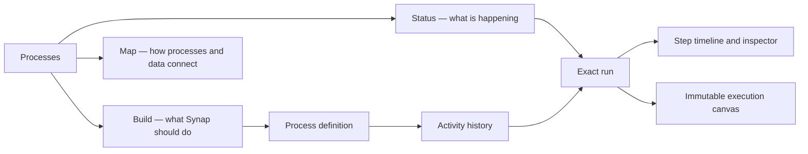

# Processes Experience — Implementation Handoff

This document is the source of truth for continuing the Processes and automation experience after the July 2026 implementation and polish pass.

The current code is green for Browser dogfooding. The next agent should first verify the experience with real pod data, finish the bounded polish described here, and resolve the semantic data-contract decisions before adding new connections such as routing process nodes to capabilities.

## Executive state

### What is implemented and verified

- Processes is one product place with three peer views: **Status**, **Build**, and **Map**.
- Status is the default operational view and treats automations and playbooks as observable services in one process fleet.
- Each process row combines identity, trigger/type, recent execution history, health, and an exact-run navigation affordance.
- Failed health text and individual run-history marks open the exact execution. There is no redundant oversized “Inspect failure” button.
- Recent run surfaces use one shared compact run ledger instead of separate card designs.
- A run opens on **Activity** by default.
- Activity and its inspector can scroll independently on wide layouts.
- Canvas is an immutable historical snapshot, initially fits the complete graph, and visually selects the corresponding node when a step is selected.
- Error presentation starts with a concise useful summary and progressively discloses raw technical evidence.
- Process/run UI components are shared between Browser and workflow cells instead of being reimplemented per surface.
- Active runtime data access in the touched UI follows `hooks → stores → client`.
- The implementation passed the full validation matrix recorded below.

### What is not complete

The operational UI foundation is complete, but the semantic contract needed for the original **“when this happens, do that”** vision is not.

Do not route new nodes to capabilities until the following are resolved:

1. Cursor pagination for definitions and grouped histories.
2. Explicit process-node metadata for input, storage effect, internal reaction, and external output.
3. A typed backend error taxonomy with safe human summaries.
4. Channel scope and outbound-destination semantics.
5. A bounded real-data visual verification pass across representative pods and viewport sizes.

## Product intent

Synap’s four primary user/AI doors are:

1. **Ask** — understand existing knowledge.
2. **Capture** — bring information into Synap.
3. **Automate** — describe what should happen over time.
4. **Diagnose** — understand what happened, why, and what needs attention.

The Automate door should let a person tell any Synap-aware AI:

> “When this happens, do that.”

The AI should discover available inputs and actions, draft a real process, show what will be created, obtain proposal-gated approval when required, activate it, and make every execution inspectable.

### Required mental separation

There are two related but different operations:

#### Get data into Synap

Examples:

- When a message arrives from a Discord channel, store the message in Synap.
- When an email arrives from a particular sender and matches a condition, create or update the appropriate Synap entity.
- When a URL is received, capture it; if it is a Drive document, link or copy it into the appropriate client context.

This side includes source connection, fetching, transformation, identity/deduplication, and storage.

#### Act from data already in Synap

Examples:

- When a stored email has a property, update its linked event.
- The first teammate who replies in a client channel becomes the account manager.
- When a new high-priority item is created, notify its owner.
- When an entity changes, update another system or send a message outward.

This side includes internal reactions, linked-data mutations, proposals, notifications, and external outputs.

This separation is a user mental model, not permission to create two unrelated engines. Both are processes over the same event, execution, governance, and observability foundations.

## Current experience architecture



### Status

Status answers:

- What is running?
- What needs attention?
- What is healthy?
- What has never run?
- What is paused or still a draft?
- What happened recently?

It is not a second run feed. It is the service-fleet view of all process definitions and their recent execution evidence.

### Build

Build answers:

- What processes exist?
- What triggers them?
- What steps will they perform?
- How can a process be created, edited, tested, paused, or activated?

The natural-language authoring door belongs here. It must draft a reviewable process rather than silently creating an opaque background task.

### Map

Map answers:

- Which data, views, tools, agents, channels, playbooks, and automations participate in the system?
- What invokes what?
- What emits data or events consumed elsewhere?

Map is system topology, not run replay. Exact run execution belongs in run detail.

### Process detail and run detail

The route hierarchy is:

1. Process fleet
2. Process detail
3. Process Activity history
4. Exact run detail
5. Selected execution step

Run detail has two peer representations of the same immutable evidence:

- **Activity**: chronological step list plus selected-step inspector.
- **Canvas**: the complete executed graph, with execution state overlaid on its nodes and edges.

Activity is the default because it is the fastest diagnostic representation. Canvas is available for structural reasoning and transformation tracing.

## Implementation map

### Browser: Processes shell and service fleet

- `browser/electron/renderer/src/apps/processors/ProcessorsHome.tsx`
  - Owns the single Processes heading and Status/Build/Map view switch.
  - Must not reintroduce a second title or a separate top-level Runs mode.
- `browser/electron/renderer/src/apps/processors/ProcessStatusView.tsx`
  - Renders process health groups and filters.
- `browser/electron/renderer/src/apps/processors/ProcessFleet.tsx`
  - Renders the grouped process fleet.
- `browser/electron/renderer/src/apps/processors/ProcessServiceRow.tsx`
  - Canonical Browser service-row composition: identity, history, state, and exact-run navigation.
- `browser/electron/renderer/src/apps/processors/processes-model.ts`
  - Presentation model and health grouping.
- `browser/electron/renderer/src/apps/processors/useProcessesOverview.ts`
  - Composes process inventory and recent activity for Status.
- `browser/electron/renderer/src/apps/processors/processesNavigation.ts`
  - Navigation requests for the singleton Processes surface.
- `browser/electron/renderer/src/apps/processors/process-status.css`
  - Status/fleet layout.

### Browser: run surfaces

- `browser/electron/renderer/src/apps/runs/RunLedgerRow.tsx`
  - Compatibility re-export of the shared implementation. Do not fork it.
- `browser/electron/renderer/src/apps/runs/RunHealthStrip.tsx`
  - Compact exact-run history marks.
- `browser/electron/renderer/src/apps/runs/RecentExecutions.tsx`
  - Pod-wide recent execution ledger.
- `browser/electron/renderer/src/apps/runs/RunsMiniList.tsx`
  - Compact embedded history.
- `browser/electron/renderer/src/apps/runs/detail/BrowserRunDetailPanel.tsx`
  - Browser host for shared run detail.
- `browser/electron/renderer/src/apps/automations/AutomationLastFailure.tsx`
  - Single compact exact-failure surface.

### Shared run-detail package

- `synap-app/packages/core/run-detail/src/RunLedgerRow.tsx`
  - Canonical run ledger row and meaningful-summary derivation.
- `synap-app/packages/core/run-detail/src/RunLedgerRow.css`
  - Shared standalone and embedded presentation.
- `synap-app/packages/core/run-detail/src/RunDetailPanel.tsx`
  - Run detail composition.
- `synap-app/packages/core/run-detail/src/RunHeaderBand.tsx`
  - Exact-run identity, status, timing, and host actions.
- `synap-app/packages/core/run-detail/src/RunInspector.tsx`
  - Activity/Canvas content and selected-step evidence.
- `synap-app/packages/core/run-detail/src/errorPresentation.ts`
  - Current frontend error-summary fallback.
- `synap-app/packages/core/run-detail/src/runViewState.ts`
  - Activity-default and run-change reset policy.
- `synap-app/packages/core/run-detail/src/snapshot.ts`
  - Converts run evidence into immutable flow state.

### Shared workflow package

- `synap-app/packages/features/workflows/src/flow/AutomationFlowEditor.tsx`
  - Build editor and read-only run Canvas mode.
  - Run mode filters mutation changes, disables deletion/connections, waits for initialized nodes, then fits the complete graph.
- `synap-app/packages/features/workflows/src/flow/AutomationFlowPreview.tsx`
  - Immutable compact preview derived directly from the current definition.
  - Must not seed definition props into one-time node/edge state.
- `synap-app/packages/features/workflows/src/flow/flowModePolicy.ts`
  - Central build/draft/run mode policy.
- `synap-app/packages/features/workflows/src/cells/AutomationRunDetailView.tsx`
  - Shared exact-run detail used by workflow cells.
- `synap-app/packages/features/workflows/src/cells/AutomationDetailCell.tsx`
- `synap-app/packages/features/workflows/src/cells/RunHistoryCell.tsx`
- `synap-app/packages/features/workflows/src/cells/automationRunLedger.ts`
  - Typed adapter from automation-specific run data to the canonical ledger.
- `synap-app/packages/features/workflows/src/components/WorkflowStatusBadge.tsx`
  - Compatibility wrapper over canonical run-detail status presentation.

### Data access boundary

- `synap-app/packages/synap-stores/src/processInventoryStore.ts`
  - Definition, run, mutation, diagnosis, and invalidation queries.
- `synap-app/packages/synap-stores/src/channelQueryStore.ts`
  - Channel query boundary used by automation configuration.
- `synap-app/packages/synap-hooks/src/useAutomationInventory.ts`
- `synap-app/packages/synap-hooks/src/useAutomationDefinitions.ts`
- `synap-app/packages/synap-hooks/src/usePlaybookDefinitions.ts`
- `synap-app/packages/synap-hooks/src/useRecentRunsByFlows.ts`
- `synap-app/packages/synap-hooks/src/useWorkspaceChannels.ts`
  - UI-facing hooks. New components must consume these or add a proper store/hook contract; they must not call tRPC directly.

## Important implementation truths

### Automation versus playbook

The prior visual inconsistency was not intentional product differentiation.

Automations and playbooks can have different icons, trigger descriptions, edit destinations, and available actions, but their operational health and execution history must use the same grammar.

Do not create separate status colors, history components, or run detail pages for them.

### Run response shape

Automation run history returns an object containing `runs`, not a bare array.

The prior UI incorrectly treated the response as an array in some cells. This has been fixed. Preserve typed adapters and do not reintroduce shape guessing.

### Partial data

Some APIs cap definition/history reads at 100 records. The UI must never claim completeness when a query is capped or activity is unavailable.

Current behavior deliberately keeps loaded processes usable and labels uncertain health. Preserve that truthfulness until cursor pagination is implemented.

### Historical immutability

A past run is evidence, not an editable definition.

In run mode:

- Nodes cannot be dragged.
- Connections cannot be created.
- Delete keys do nothing.
- Node settings and destructive controls are unavailable.
- Selection is allowed for inspection.
- The complete graph is initially fitted.
- Opening a selected failed step must not auto-zoom away from global context.

### Failure navigation

The displayed health/failure information is itself the navigation affordance.

Do not add a second “Inspect failure” button beside “Latest run failed.” The status surface should be keyboard accessible and route to the exact run ID.

### Error presentation

Do not show raw SQL, Zod arrays, or executor payloads as the primary message.

The current frontend helper provides a concise fallback and retains technical evidence in progressive disclosure. This is transitional. The correct long-term contract is typed backend error codes plus a safe human-facing summary.

## Work completed in this pass

1. Consolidated Processes and Runs into one Processes place with Status/Build/Map views.
2. Removed the duplicate “Needs you now” block from Status.
3. Removed the old run feed appended below the process fleet.
4. Replaced redundant action-heavy rows with service-style process rows.
5. Made health status and history marks route to exact runs.
6. Replaced nested run cards with one compact shared ledger.
7. Made Activity the default exact-run view.
8. Added independent Activity/inspector scrolling on wide layouts.
9. Made Canvas a read-only historical snapshot and fitted the complete graph after node initialization.
10. Kept selected Activity steps visibly selected on Canvas without forced zoom.
11. Added progressive error summaries and technical-detail disclosure.
12. Consolidated duplicated Browser/workflow status and run renderers into shared packages.
13. Migrated touched UI runtime data access to hooks and stores.
14. Added state resets when cell automation IDs change.
15. Fixed stale read-only previews that retained the previous automation graph.
16. Removed touched React Flow `any` callback casts using exported callback types.
17. Fixed Browser integration type drift around workspace creation, proposal-type resolution, surface lenses, and canonical sidebar identities.

## Verification already completed

Validated on 2026-07-31:

| Gate | Result |
|------|--------|
| Browser unit/component suite | 56 files, 407 tests passed |
| Shared targeted run/workflow suite | 20 distinct tests passed |
| AutomationFlowPreview regression | Passed |
| Browser full TypeScript | Passed |
| `@synap-core/stores` typecheck | Passed |
| `@synap-core/hooks` typecheck | Passed |
| `@synap-core/run-detail` typecheck | Passed |
| `@synap-core/workflows` typecheck | Passed |
| Browser production build | Passed |
| Browser and synap-app `git diff --check` | Passed |
| Independent code review | Green after fixes |
| Independent UI/UX review | Green after three must-fix corrections |

### Reproduction commands

From `browser/`:

```bash
pnpm exec tsc --noEmit --pretty false
pnpm test
pnpm build
git diff --check
```

From `synap-app/`:

```bash
pnpm --filter @synap-core/stores typecheck
pnpm --filter @synap-core/hooks typecheck
pnpm --filter @synap-core/run-detail type-check
pnpm --filter @synap-core/workflows type-check
pnpm exec vitest run \
  packages/core/run-detail/src/runViewState.test.ts \
  packages/core/run-detail/src/errorPresentation.test.ts \
  packages/core/run-detail/src/runDiagnosisState.test.ts \
  packages/core/run-detail/src/snapshot.test.ts \
  packages/features/workflows/src/flow/flowModePolicy.test.ts \
  packages/features/workflows/src/flow/AutomationFlowPreview.test.tsx \
  packages/features/workflows/src/components/WorkflowStatusBadge.test.tsx \
  packages/features/workflows/src/cells/automationRunLedger.test.ts
git diff --check
```

Use `pnpm exec vitest` from `synap-app`; do not invoke the parent workspace’s older Vitest binary.

### Accepted non-blocking build warnings

The Browser production build currently reports existing warnings for:

- circular manual chunks;
- modules imported both dynamically and statically;
- large renderer chunks.

These did not block this feature, but should eventually become a dedicated bundle-health task.

## Runtime verification still required

The code was validated without access to the user’s production-like pod data. Before calling the experience visually final, dogfood the following.

### Representative pods

Verify at least:

- one pod with many automations, playbooks, failures, drafts, and long histories;
- one pod with little or no run history;
- one pod where an activity query is temporarily unavailable or partial.

Expected result: all pods retain the same visual grammar. Missing history changes the truthful state, not the component design.

### Process fleet

- Only one page title is visible.
- Status/Build/Map are peers and retain the same Processes surface.
- No duplicate “Needs you now” block appears in Status.
- No old run feed appears after the fleet.
- Filters sit directly above the fleet and remain usable at narrower widths.
- Automation and playbook rows share layout and health semantics.
- Needs-attention, running, healthy, paused, draft, and never-run groups render correctly.
- Long names and trigger descriptions truncate without shifting health/actions.
- A failed status opens the exact failed run.
- Every history mark opens its own exact run.

### Process detail

- Recent runs are compact rows, not separate floating cards.
- Latest failure is one clickable surface.
- Generic “This run failed.” is replaced by a useful error summary when evidence exists.
- Switching quickly between processes never retains the prior process’s runs, selected run, flow, success state, or failure state.

### Exact run detail

- Activity opens first for every new run.
- Selecting Canvas and then navigating to another run resets the next run to Activity.
- The Activity list and inspector scroll independently in a short window.
- The first failed step is selected, visible, and not hidden by overflow.
- Canvas opens fitted to the complete graph.
- The selected Activity step is visibly selected on Canvas.
- Canvas cannot mutate the historical flow through dragging, connecting, delete keys, or settings.
- Technical error detail remains accessible without dominating the default view.

### Viewports

Perform one pass at:

- wide desktop;
- narrow desktop/split view;
- short-height window.

Pay particular attention to embedded ledger rows: empty steps or summary cells must not leave blank responsive bands.

## Remaining polish

These are bounded improvements and do not require new architecture.

### Recommended before wider release

- Standardize visible successful-state language. Recommendation: use **Completed** in UI while keeping `succeeded` as an internal status where required.
- Make the run-detail return breadcrumb host-aware; “Runs” is misleading when returning to a process Activity facet.
- Increase the breadcrumb and small history-mark pointer targets before reusing them on mobile.
- Convert remaining touched raw pixel values to the appropriate spatial/design tokens where practical.
- Consolidate duplicated trigger invalidation logic in `processInventoryStore.ts` so the CRUD and standalone trigger hooks cannot drift.

### Do not solve with client heuristics

- Human error semantics belong in a backend error contract.
- Get/store/react/send classification belongs in explicit definition metadata.
- Definition completeness belongs in cursor-pagination metadata.

## Product and data-contract decisions before capability routing

### 1. Cursor pagination

Current definition/status reads can cap at 100 records. Required contract:

- cursor or continuation token;
- `hasNextPage`/equivalent;
- stable ordering;
- aggregation semantics that do not classify an unseen recent run as “never run”;
- UI loading and partial-state behavior.

Do not hide the limitation by increasing the fixed limit.

### 2. Process-node intent metadata

The desired user contract is:

- **Gets data** — source acquisition or query.
- **Stores** — persistence into Synap.
- **Reacts** — internal computation or mutation caused by stored data.
- **Sends** — side effect outside the current Synap data context.

Current node labels/types are insufficient to classify this truthfully. Add explicit metadata rather than guessing from titles, tools, or icons.

A candidate shape to validate—not implement blindly—is:

```ts
type ProcessNodeIntent =
  | { kind: 'input'; source: 'synap' | 'connector' | 'webhook' | 'schedule' | 'manual' }
  | { kind: 'store'; target: 'entity' | 'document' | 'file' | 'relation'; operation: 'create' | 'upsert' | 'update' }
  | { kind: 'reaction'; operation: string }
  | { kind: 'output'; destination: 'channel' | 'connector' | 'webhook' | 'notification' | 'email' };
```

Questions to resolve:

- Is intent singular per node or can one capability both store and send?
- Is transformation represented on a node, an edge, or execution evidence between nodes?
- Which metadata is definition-time versus run-time?
- How are secrets and connector configuration referenced without exposing them?
- Which mutations require proposals or explicit activation review?

### 3. Channel scope and direction

The existing UI still has unresolved semantics:

- Should channel selection follow the current lens or the automation’s owned workspace?
- How should pod-wide automations select workspace-scoped channels?
- Outbound `channelId` must not be conflated with inbound trigger configuration.
- Channel discovery needs search/pagination for large installations.

Treat inbound sources and outbound destinations as separate contracts.

### 4. Capability routing

Only after the intent metadata is stable should nodes route to capabilities.

The routing design must answer:

- How an AI discovers a compatible capability for an intent.
- How capability input/output schemas are matched to process data.
- How the user sees required connector setup before activation.
- How unavailable capabilities degrade without corrupting the definition.
- How proposal governance applies to mutations.
- How run evidence records the chosen capability version.

Do not add capability-specific rendering to the run ledger or process service row. Capability detail belongs at definition-node and run-step depth.

## Guardrails for the next agent

### Architecture

- Preserve `React component → hooks → stores → client → backend`.
- A type-only import from the client package may be acceptable at a package boundary; runtime queries and mutations are not.
- Keep the shared run ledger and run detail canonical in `@synap-core/run-detail`.
- Do not create Browser-only copies of shared statuses, rows, or error presentation.
- Preserve registered cell keys and existing route compatibility.
- Use the Cell system for reusable rendering.
- AI mutations must go through proposal governance; never bypass `checkPermissionOrPropose()`.

### Product

- Do not split Processes and Runs back into separate primary product places.
- Do not add a fourth primary Processes view without a validated need.
- Do not make Canvas the default run view.
- Do not make historical Canvas editable.
- Do not reintroduce nested run cards, “Version 1” as the primary run title, redundant failure buttons, or oversized empty surfaces.
- Do not infer Get/Store/React/Send semantics from display labels.
- Do not present capped/partial results as complete.
- Keep the default experience concise; reveal technical evidence progressively.

### Change safety

- The workspace is frequently dirty across multiple repos. Inspect scoped diffs and preserve unrelated user work.
- Reset local cell state when identity props such as `automationId` or `runId` change.
- Test both replacement-prop behavior and first mount for preview/detail components.
- When modifying shared rendering, verify Browser and workflow-cell consumers.
- Prefer adapters at data boundaries over optional-prop accumulation in visual components.

## Recommended continuation sequence

### Phase 0 — real-data visual smoke test

Run the runtime checklist above. Fix only clear implementation defects. Record screenshots for rich, empty, partial, narrow, and short-window states.

Exit condition: the implemented experience matches this document across representative pods.

### Phase 1 — bounded visual and copy polish

Resolve success vocabulary, breadcrumb labeling/targets, compact-history target sizing, token drift, and trigger invalidation duplication.

Exit condition: no known UI inconsistency requires reinterpretation of the process data model.

### Phase 2 — semantic process contract

Design and implement cursor pagination, typed error presentation, input/store/reaction/output intent metadata, and channel direction/scope.

Exit condition: the UI and AI can explain a process truthfully without inspecting labels or implementation-specific node types.

### Phase 3 — capability discovery and routing

Connect intent metadata to the capability marketplace, schema matching, connector readiness, proposals, and versioned run evidence.

Exit condition: an AI can turn “when X, do Y” into a reviewable, executable, observable process using available Synap capabilities.

## Definition of ready before Phase 3

Capability routing may begin only when all of the following are true:

- Runtime visual smoke tests pass across representative pods and viewports.
- Definition and history pagination are complete or intentionally bounded with a documented contract.
- Every routable node has explicit intent and schema metadata.
- Inbound sources and outbound destinations are distinct.
- Backend errors expose safe typed summaries.
- Proposal behavior is defined for each mutation class.
- The shared run-detail surface can display capability/version evidence without a renderer fork.
- External agents and CLI consumers have the required generated/published API types.

## External design references

- [n8n executions](https://docs.n8n.io/workflows/executions/all-executions/) — past executions are loaded and inspected as historical evidence rather than edited as live definitions.
- [React Flow `useNodesInitialized`](https://reactflow.dev/api-reference/hooks/use-nodes-initialized) — fit/measurement behavior should wait until nodes are initialized.

These are supporting patterns, not product specifications. Synap’s distinguishing contract remains governed automation over sovereign centralized data, with natural-language creation and end-to-end observability.

